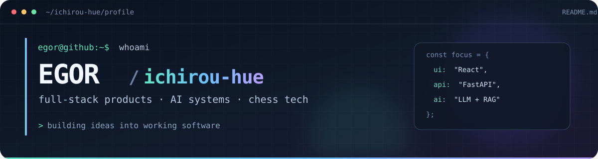

<p align="center">
  
</p>

<div align="center">

### Привет! Я Егор 👋

**Full-stack разработчик · Project Lead в [SFEDUCASTLING](https://github.com/ichirou-hue/SFEDUCASTLING)**

Делаю веб-продукты целиком: проектирую API и данные, собираю интерфейсы, связываю сервисы и добавляю AI там, где он решает конкретную задачу.

[Проекты](https://github.com/ichirou-hue?tab=repositories) · [Мой GitHub](https://github.com/ichirou-hue)

</div>

---

### `01 / featured_projects`

| Проект | Что внутри | Мой вклад |
|:--|:--|:--|
| **[CoolChess ♜](https://github.com/ichirou-hue/CoolChess)** | Шахматная платформа с курсами, задачами, игрой с ботом, PvP через WebSocket, рейтингом и турнирами. | Разработка и развитие full-stack продукта. |
| **[SFEDUCASTLING ♟️](https://github.com/ichirou-hue/SFEDUCASTLING)** | AI-платформа для обучения шахматам: анализ Stockfish, игра с Maia3, объяснения ходов через LLM, персональные задания. | Руководство проектом, архитектура, интеграция LLM/GigaChess. |

Небольшой CV-эксперимент: [детекция лиц с OpenCV](https://github.com/ichirou-hue/BoundingBoxTested-).

### `02 / tech_stack`

```text
Frontend      React · TypeScript · JavaScript · Vite
Backend       Python · FastAPI · SQLAlchemy · PostgreSQL · SQLite
AI / ML       PyTorch · Transformers · QLoRA · RAG · OpenCV
Engineering   Docker · WebSocket · Alembic · GitHub Actions · pytest
```

### `03 / what_i_build`

- **Продукты целиком:** связка интерфейса, API, базы данных и ML-компонентов в работающем приложении.
- **Системы для обучения:** задачи, адаптивная сложность, прогресс и игровые сценарии для шахматистов.
- **AI, который можно проверить:** LLM-разборы шахматных позиций с фактическим контекстом, валидацией ответов и оценкой моделей.

<div align="center">

<sub>Открыть код → <a href="https://github.com/ichirou-hue?tab=repositories">github.com/ichirou-hue</a></sub>

</div>
