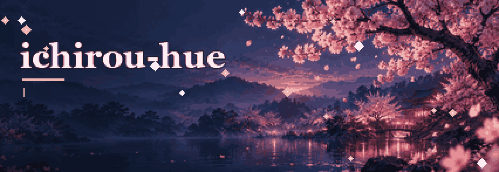

---

### 👋 Обо мне

- 🔭 Учусь создавать веб-продукты: разбираюсь в интерфейсах, API и данных и хочу уверенно писать код самостоятельно
- 🎯 Моя цель — вырасти в full-stack разработчика через собственные проекты и регулярную практику
- ♟️ Project Lead в [SFEDUCASTLING](https://github.com/ichirou-hue/SFEDUCASTLING): Stockfish, Maia3, LLM-разборы партий
- ♜ Автор [CoolChess](https://github.com/ichirou-hue/CoolChess): PvP через WebSocket, рейтинг, турниры
- 🧠 Интересуюсь RAG, QLoRA и проверяемым AI

---

### 🛠 Стек

**Frontend**

  

**Backend & Data**

  

**AI / ML**

  

**Engineering**

  

---

### 🚀 Проекты

| Проект                                                                     | Описание                                                                         | Стек                                                                                                                                                                                                                                                          |
| :------------------------------------------------------------------------- | :------------------------------------------------------------------------------- | :------------------------------------------------------------------------------------------------------------------------------------------------------------------------------------------------------------------------------------------------------------ |
| [**CoolChess ♜**](https://github.com/ichirou-hue/CoolChess)                | Шахматная платформа: курсы, задачи, игра с ботом, PvP, рейтинг и турниры         |    |
| [**SFEDUCASTLING ♟️**](https://github.com/ichirou-hue/SFEDUCASTLING)       | AI-платформа для обучения шахматам: Stockfish, Maia3, объяснения ходов через LLM |                                                                                        |
| [**BoundingBoxTested**](https://github.com/ichirou-hue/BoundingBoxTested-) | Эксперимент: детекция лиц с OpenCV                                               |                                                                                                                                                                             |

---

### 📊 Статистика GitHub

  
  

  

---

### 📫 Связаться

  

