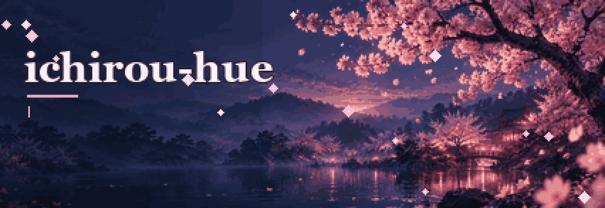

---

### 👋 Обо мне

- 🔭 Учусь создавать веб-продукты: разбираюсь в интерфейсах, API и данных и хочу уверенно писать код самостоятельно
- 🎯 Моя цель — вырасти в full-stack разработчика через собственные проекты и регулярную практику
- ♟️ Project Lead в [SFEDUCASTLING](https://github.com/ichirou-hue/SFEDUCASTLING): Stockfish, Maia3, LLM-разборы партий
- ♜ Автор [CoolChess](https://github.com/ichirou-hue/CoolChess): PvP через WebSocket, рейтинг, турниры
- 🧠 Интересуюсь RAG, QLoRA и проверяемым AI

---

### 🛠 Стек

**Frontend**

  

**Backend & Data**

  
